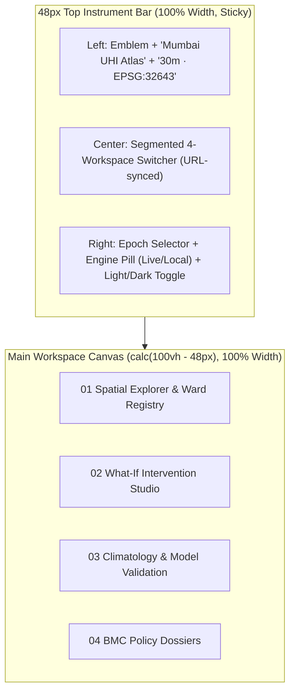

# Mumbai UHI Platform — UI Makeover & Architecture Specification

> **Design Archetype:** **Cartographic & Scientific Research Workbench** (*Observable / NASA VEDA / Felt / Mapbox Studio*).  
> **Status:** Approved Architecture Specification  
> **Scope:** Frontend UI Makeover (`frontend/src/`)

---

## 1. Product Archetype & Anti-"AI Slop" Guardrails

### What We Are Eliminating vs. What Replaces It
| Legacy "AI Slop" Pattern | New Workbench Standard |
| :--- | :--- |
| Deep navy `#07111F` + neon cyan `#00D2FF` + glowing purple boxes | **Dual-Theme Neutral Stone & Carbon Chrome** with **Terracotta `#D94E34`** interactive accent; chromatic color reserved strictly for scientific data |
| `animate-ping` / `animate-pulse` red & green status dots everywhere | Quiet static status indicators (`Live API · 4ms` or `Local Engine`) with zero distracting animations |
| 8 fragmented sidebar tabs + 6 giant top KPI cards + fake `[INFO]` stdout logs | **4 Purpose-Built Workspaces** inside a single **48px Top Instrument Bar** (100% viewport width freed; fake `System` terminal page removed) |
| Map only colors 24 coarse ward polygons | **Multi-Resolution Cartography**: HTML5 Canvas interpolation of `thermalGrid.json` + crisp BMC Ward GeoJSON vectors + Before/After split-curtain slider |
| Broken `"Roadmap Item"` yellow warning banner in Reports | Authentic typeset **BMC Climate Action Dossier** with working `@media print` PDF formatting & instant CSV/JSON data export |

---

## 2. Color Theme & Perceptual Data Palettes

### 2.1 Dual-Theme UI Chrome Tokens (CSS Custom Properties)
UI surfaces use warm, desaturated stone (Light) and neutral carbon/graphite (Dark) with **zero blue or neon tint** so thermal and biophysical colormaps remain perceptually accurate.

| Semantic Token | CSS Variable | Daylight Paper (Light) | Carbon Workbench (Dark) | Usage |
| :--- | :--- | :--- | :--- | :--- |
| **Canvas Base** | `--bg-canvas` | `#F6F5F0` (Warm Alabaster) | `#0E0F11` (Carbon Black) | App background & recessed wells |
| **Card Surface** | `--bg-surface` | `#FFFFFF` (Crisp Paper) | `#16181B` (Graphite Panel) | Primary cards, docks, & panels |
| **Elevated / Hover** | `--bg-elevated` | `#EFECE6` (Warm Stone) | `#1F2227` (Elevated Slate) | Table row hover, secondary pills, active controls |
| **Subtle Border** | `--border-subtle` | `#E2DFD7` | `#272A30` | 1px card & table dividers |
| **Strong Border** | `--border-strong` | `#C8C4B8` | `#383C44` | Active input focus & emphasized frames |
| **Primary Ink** | `--text-primary` | `#161615` (Deep Charcoal) | `#F2F0EC` (Warm Off-White) | Headings, primary values, body copy |
| **Secondary Ink** | `--text-secondary` | `#57554F` | `#A09E97` | Subtitles, axis labels, table metadata |
| **Muted Ink** | `--text-muted` | `#85827A` | `#6E6C66` | Captions, units, disabled states |
| **Primary Accent** | `--accent-primary` | `#D94E34` (Terracotta) | `#E55A40` (Solar Vermilion) | Active workspace indicator, primary CTAs, selected state |
| **Accent Subtle** | `--accent-subtle` | `rgba(217, 78, 52, 0.10)` | `rgba(229, 90, 64, 0.14)` | Selected ward row highlight, active pill background |

### 2.2 Perceptual Scientific Data Scales
1. **Land Surface Temperature (`LST`, 29.0°C – 38.5°C) — *Inferno / Thermal Scale*:**
   - `#2B0B3F` (29°C SGNP Cool Sink) → `#721F81` (31.5°C) → `#B63679` (33.5°C) → `#E65164` (35.5°C) → `#FB8761` (37.0°C) → `#FBB41A` (38.5°C Peak Industrial/Slum Heat).
2. **Vegetation Canopy (`NDVI`, 0.05 – 0.65) — *YlGn Botanical Scale*:**
   - `#A6611A` (Bare/Impervious `<0.10`) → `#DFC27D` (`0.20`) → `#A6D96A` (`0.35`) → `#31A354` (`0.50`) → `#006837` (`>0.60` Dense Forest).
3. **Built-Up Density (`NDBI`, -0.15 – +0.60):**
   - `#2B83BA` (Low/Natural) → `#F7F7F7` (Moderate) → `#D7191C` (Extreme Impervious Core).
4. **Diverging Thermal Anomaly & TreeSHAP Attribution (`-Cooling` vs. `+Heating` ΔT):**
   - **Cooling / Negative ΔT:** `#0D9488` (Deep Teal) → `#2DD4BF` (Seafoam Teal)
   - **Neutral (0.0°C):** `#D6D3CD` (Light) / `#3F4248` (Dark)
   - **Heating / Positive ΔT:** `#F97316` (Warm Amber) → `#D94E34` (Vermilion) → `#B91C1C` (Crimson)

---

## 3. Typography & Visual Density System

### 3.1 Font Stack (Google Fonts — IBM Plex Superfamily)
- **Editorial & Analytical Headings (`font-serif`):** `'IBM Plex Serif', Georgia, serif`
  - Used for Dossier titles, major workspace section headers, and key analytical findings.
- **UI & Controls (`font-sans`):** `'IBM Plex Sans', -apple-system, sans-serif`
  - Used for navigation, buttons, form controls, table text, and descriptions.
- **Telemetry, Coordinates & Tabular Data (`font-mono`):** `'IBM Plex Mono', monospace` with `font-variant-numeric: tabular-nums`
  - Used strictly for temperatures (`37.3°C`), deltas (`+1.41°C`), coordinates (`19.0760°N`), p-values (`p = 3.64e-5`), and ward IDs (`G/N`, `M/E`).

### 3.2 Card & Elevation Rules
- **Soft Card Grid:** `12px–16px` (`gap-3` / `gap-4`) spacing between structural cards.
- **Border Radius:** `6px–8px` (`rounded-md` / `rounded-lg`) for cards and containers; `4px` (`rounded`) for inner buttons and pills.
- **Borders & Shadows:** `1px solid var(--border-subtle)` with subtle ambient elevation (`shadow-sm` in Light, `0 4px 20px -2px rgba(0,0,0,0.35)` in Dark).
- **Icon Discipline:** Muted `14px–16px` Lucide icons for functional affordances only; zero neon icon boxes.

---

## 4. Global App Shell & Navigation Architecture



- **No Left Sidebar:** Eliminates the 256px permanent sidebar so maps, tables, and 3-column studios get 100% horizontal viewport width.
- **URL Query State Sync:** Switching workspaces (`?view=explorer|studio|science|dossier`) and selecting a ward (`&ward=G/N`) syncs with the browser URL for deep-linking and back/forward navigation.

---

## 5. Page-by-Page Section Architecture & Spatial Placement

### Workspace 01: Spatial Explorer & Ward Registry
**Purpose:** Primary cartographic exploration of Mumbai's 30m surface temperature and biophysical layers, synchronized with the 24 BMC municipal wards registry and ward-level TreeSHAP inspection.

```
+--------------------------------------------------------------------------------------------------+
| 48px Top Instrument Bar: [Mumbai UHI Atlas]   [01 Explorer | 02 Studio | 03 Science | 04 Dossier] |
+------------------------------------------------------------+-------------------------------------+
|                                                            | RIGHT ANALYTICAL DOCK (38% Width)   |
|  LEFT / CENTER MAP CANVAS (62% Width)                      |                                     |
|                                                            | [Mode A: Default Citywide View]     |
|  +------------------------------------------------------+  | 1. Search + Zone Filter + Sort Bar  |
|  | Floating Top-Left Layer Bar:                         |  | 2. 24-Ward Microclimate Table       |
|  | [LST] [NDVI] [NDBI] [Albedo] [MNDWI] [Elev]          |  |    (ID, Name, LST °C + inline bar,  |
|  | View Mode: [Fine Grid | Ward Choropleth | Combined]  |  |     UHI ΔT, NDVI, NDBI, Risk Class) |
|  +------------------------------------------------------+  | 3. Pinned Bottom Card:              |
|                                                            |    Citywide TreeSHAP Drivers        |
|                                                            | ----------------------------------- |
|                 Interactive Leaflet Map                    | [Mode B: When a Ward is Selected]   |
|       (Auto-syncs Positron Light / Dark Matter tiles       | ← Back to All 24 Wards              |
|        + Canvas thermalGrid.json + Ward Vectors)           | 1. Ward Header, Risk & Pop Density  |
|                                                            | 2. Biophysical Profile vs City Mean |
|  +-----------------------+  +---------------------------+  | 3. Local TreeSHAP Attribution Chart |
|  | Bottom-Left:          |  | Bottom-Right Telemetry:   |  | 4. Action Footer:                   |
|  | Continuous Colorbar   |  | Mean 34.2°C · Peak 37.3°C |  |    [Simulate Cooling →]             |
|  | Legend + Hover Value  |  | Cool Sink 29.5°C · 24 Wds |  |    [Open Policy Dossier →]          |
|  +-----------------------+  +---------------------------+  +-------------------------------------+
```

---

### Workspace 02: What-If Intervention Studio
**Purpose:** Real-time microclimate intervention testing (Canopy augmentation, Cool Roof albedo, Impervious surface depaving) with instant visual Before/After comparison and energy demand modeling.

```
+--------------------------------------------------------------------------------------------------+
| 48px Top Instrument Bar                                                                          |
+---------------------------+----------------------------------------+-----------------------------+
| LEFT CONTROL COLUMN (26%) | CENTER COMPARISON MAP CANVAS (46%)     | RIGHT IMPACT COLUMN (28%)   |
|                           |                                        |                             |
| 1. Target Scope Selector  | +------------------------------------+ | 1. Thermal Shift Summary    |
|    - BMC Ward Dropdown OR | | Map Mode Bar:                      | |    Baseline °C → Post °C    |
|    - [Draw Custom Polygon]| | [Split Curtain] [ΔT Anomaly] [Post]| |     Hero ΔT Cooling Readout  |
|      with live km² area   | +------------------------------------+ |    + Latency ms badge       |
|                           |                                        |                             |
| 2. Empirical Policy       |           BEFORE  |  AFTER             | 2. Grid Cell ΔT Histogram   |
|    Scenarios (5 Compact   |        Baseline   |  Simulated         |    Distribution of cooling  |
|    Selectable Cards)      |          LST      |<->|  LST           |    across target cells      |
|                           |                   |                    |                             |
| 3. Biophysical Sliders    |      Draggable Vertical Split          | 3. HVAC Energy & Carbon ROI |
|    - Tree Canopy (ΔNDVI)  |      Curtain Handle across Map         |    kWh/m²/yr saved + peak   |
|    - Cool Roofs (ΔAlbedo) |                                        |    grid load offset         |
|    - Depaving (ΔNDBI)     | +------------------------------------+ |                             |
|    (Live debounced 100ms  | | Bottom Legend:                     | | 4. Biophysical Flux Shift   |
|     simulation + Reset)   | | LST Scale + ΔT Cooling Scale       | |    SHAP driver delta bars   |
+---------------------------+----------------------------------------+-----------------------------+
```

---

### Workspace 03: Climatology & Model Validation
**Purpose:** Scientific evidence, 28-year IMD meteorological trend verification (1997–2024), XGBoost vs. Random Forest spatial cross-validation benchmarks, and multi-scope TreeSHAP explainability.

```
+--------------------------------------------------------------------------------------------------+
| Top Sub-Header: [Mode A: 28-Year IMD Climatology (1997–2024)]  [Mode B: Spatial ML & TreeSHAP]   |
| Summary Metrics Strip: Records: 383,640 · Mann-Kendall Z: +4.129 (p = 3.64e-5) · RMSE: 2.05°C    |
+------------------------------------------------------+-------------------------------------------+
| [WHEN MODE A IS ACTIVE: 28-YEAR IMD CLIMATOLOGY]                                                 |
|                                                      |                                           |
| LEFT COLUMN (55% Width):                             | RIGHT COLUMN (45% Width):                 |
| 1. Annual Mean Temperature & Sen's Slope Chart       | 1. 28 × 12 Monthly Anomaly Matrix         |
|    - 1997–2024 observed series + +0.44°C/dec trend   |    - Perceptual Vermilion-Teal heatmap    |
|    - Toggleable secondary axis for RH (%) & VPD (kPa)|    - Hover cell inspection readout        |
| 2. Urban Amplification Analytical Synthesis Card     | 2. 12-Month Climatological Norms Strip    |
|    - Coastal vs. inland nocturnal heat trap findings |    - Monthly mean, σ std dev, min/max     |
+------------------------------------------------------+-------------------------------------------+
| [WHEN MODE B IS ACTIVE: SPATIAL ML & TREESHAP XAI]                                               |
|                                                      |                                           |
| LEFT COLUMN (48% Width):                             | RIGHT COLUMN (52% Width):                 |
| 1. Model Benchmark Table & Error Bars                | 1. Interactive TreeSHAP Attribution Card  |
|    - XGBoost vs. Random Forest (RMSE, MAE, R²)       |    - Scope Switcher: [Citywide]           |
|    - Train (2,306) / Test (137) / 5-Fold metrics     |      [Single Ward] [Compare 2 Wards]      |
| 2. Spatial Block K-Fold Geometry Card                |    - Diverging horizontal bar chart       |
|    - Precision SVG diagram of Mumbai 5-fold blocks   |      (+Heating Vermilion vs -Cooling Teal)|
|    - Interactive 0.5km / 1.2km / 2.0km buffer toggle |    - Physical interpretation table        |
+------------------------------------------------------+-------------------------------------------+
```

---

### Workspace 04: BMC Policy Dossiers
**Purpose:** Authoritative municipal briefing generator for Brihanmumbai Municipal Corporation (BMC) ward officers, combining baseline vulnerability, local SHAP drivers, and simulated intervention targets into a print-ready document.

```
+--------------------------------------------------------------------------------------------------+
| 48px Top Instrument Bar                                                                          |
+---------------------------------+----------------------------------------------------------------+
| LEFT CONFIGURATION PANEL (32%)  | RIGHT TYPESET DOCUMENT SHEET (68% Width, Scrollable Preview)   |
|                                 |                                                                |
| 1. Dossier Parameters           | +------------------------------------------------------------+ |
|    - Target BMC Ward Selector   | | BRIHANMUMBAI MUNICIPAL CORPORATION • CLIMATE ACTION CELL   | |
|    - Observation Epoch Selector | | Ward G/N (Dharavi / Dadar) — UHI Assessment & Action Plan  | |
|    - Policy Scenario Selector   | |============================================================| |
|      (or Custom Simulation)     | | §1. Executive Ward Profile & Thermal Vulnerability         | |
|                                 | |     Tabular summary + Inline SVG Ward Locator Mini-Map     | |
| 2. Cross-Ward Quick Comparison  | |                                                            | |
|    - Rank position out of 24    | | §2. Local Biophysical Attribution (TreeSHAP Decomposition) | |
|    - Delta vs. City Mean LST    | |     Exact °C contributions of NDBI, NDVI, Albedo, Coast    | |
|                                 | |                                                            | |
| 3. Export & Distribution        | | §3. Simulated Mitigation Impact & Energy ROI               | |
|    - [Print / Save as PDF]      | |     Baseline vs. Target LST, ΔT Cooling, kWh/m²/yr offset  | |
|      (Dedicated @media print)   | |                                                            | |
|    - [Export Ward CSV]          | | §4. DCPR 2034 Municipal Implementation Directives          | |
|    - [Export Dossier JSON]      | |     Tailored engineering mandates for the selected ward    | |
+---------------------------------+----------------------------------------------------------------+
```

---

## 6. Technical Architecture & File Plan

### 6.1 Technology Stack
- **Core:** React 19 + TypeScript + Vite 8 + Tailwind CSS 3.4
- **State Management:** Zustand (`useUhiStore.ts`) extended with `theme: 'light' | 'dark'`, `mapRenderMode: 'grid' | 'choropleth' | 'combined'`, `comparisonMode: 'split' | 'delta' | 'post'`, and URL query synchronization.
- **Cartography:** Leaflet 1.9 + Custom HTML5 `<canvas>` bilinear/grid overlay for `thermalGrid.json` + SVG GeoJSON layer for `wardsData.json` + Interactive Split-Curtain slider.
- **Data Visualization:** Recharts + Custom precision SVG components (Monthly Anomaly Matrix, Diverging SHAP Waterfall, Spatial Block K-Fold SVG Diagram, Mini Ward Locator SVG).

### 6.2 Planned File Structure (`frontend/src/`)
- `index.css` & `tailwind.config.js` — IBM Plex font imports, dual-theme CSS variables (`:root` and `.dark`), perceptual color scale utilities, and `@media print` dossier rules.
- `stores/useUhiStore.ts` — Unified state for workspaces, theme, map render mode, live debounced simulation, and URL sync.
- `utils/colorScales.ts` — Scientific color interpolators (`getInfernoColor`, `getNdviColor`, `getNdbiColor`, `getDivergingDeltaColor`) and export helpers (`exportWardCsv`, `exportDossierJson`).
- `components/layout/TopInstrumentBar.tsx` — 48px global header replacing `Header.tsx` and `Sidebar.tsx`.
- `components/map/MumbaiMap.tsx` — Multi-resolution Leaflet + HTML5 Canvas grid + Split-Curtain comparison + floating layer/mode controls + continuous colorbar legend.
- `pages/SpatialExplorer.tsx` — Workspace 01 (62% Map Canvas + 38% Synchronized Ward Registry / Ward Inspector Dock).
- `pages/InterventionStudio.tsx` — Workspace 02 (3-Zone Non-Scrolling Simulator Studio).
- `pages/ClimatologyValidation.tsx` — Workspace 03 (2-Mode Research Workbench: 28-Yr IMD Climatology + Spatial ML & Multi-Scope TreeSHAP).
- `pages/PolicyDossiers.tsx` — Workspace 04 (Split Dossier Studio with SVG ward mini-map, print stylesheet, and CSV/JSON export).
